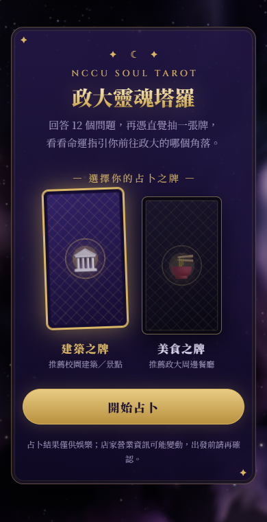
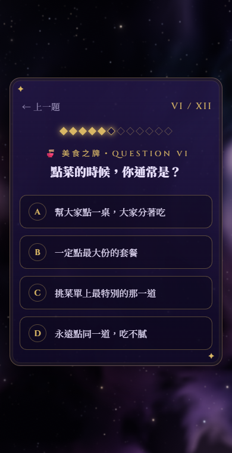
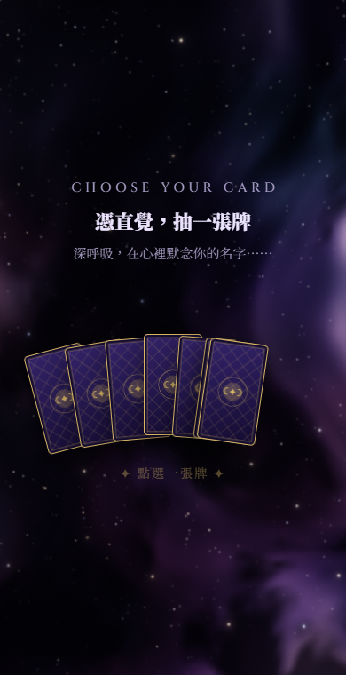
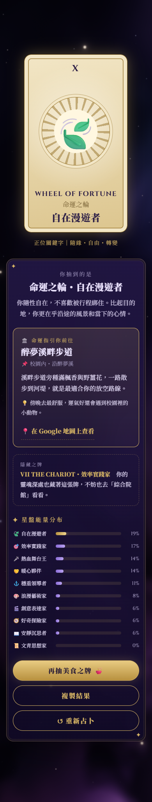
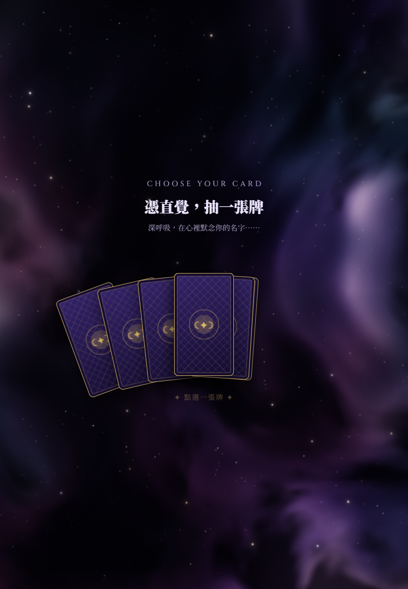
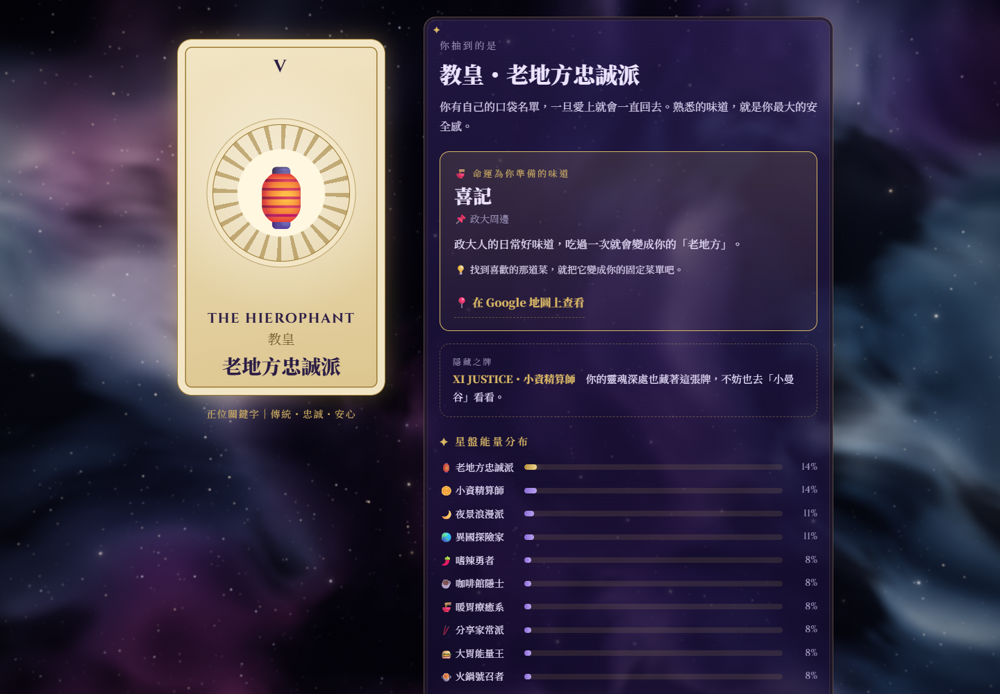

# 🔮 政大靈魂塔羅 NCCU Soul Tarot

> 回答 12 個問題，再憑直覺抽一張牌，看看命運指引你前往政大的哪個角落。

**👉 立即占卜：https://zhaoweiliu113703005.github.io/nccu-soul-tarot/**

結合「心理測驗」與「塔羅抽牌」的互動網頁，測出你的校園人格，推薦一個最適合你的**政大建築／景點**或**周邊餐廳**。手機、平板、電腦都能玩。

  
  
  

---

## ✨ 玩法

1. **選擇牌組**：🏛️ 建築之牌（推薦校園建築）或 🍜 美食之牌（推薦周邊餐廳）
2. **回答 12 題**：兩副牌的題目不同。建築之牌問個性與校園生活，美食之牌問口味、預算、和誰一起吃
3. **命運之輪轉動**：解讀你的靈魂頻率
4. **抽一張牌**：從扇形排開的 7 張牌中，憑直覺點選一張
5. **翻牌揭曉**：看看你是哪張塔羅牌、命運指引你去哪裡

## 🃏 牌組一覽

### 🏛️ 建築之牌

| 塔羅牌 | 人格 | 命定之地 |
|---|---|---|
| 0 愚者 THE FOOL | 🧭 好奇探險家 | 達賢圖書館 |
| I 魔術師 THE MAGICIAN | 🎬 創意表達家 | 傳播學院大樓 |
| II 女祭司 THE HIGH PRIESTESS | 📜 文青思想家 | 百年樓 |
| III 皇后 THE EMPRESS | 🤝 暖心夥伴 | 安九 |
| IV 皇帝 THE EMPEROR | ⚓ 穩重領導者 | 行政大樓 |
| VII 戰車 THE CHARIOT | 🎯 效率實踐家 | 綜合院館 |
| IX 隱者 THE HERMIT | 📖 安靜沉思者 | 中正圖書館 |
| X 命運之輪 WHEEL OF FORTUNE | 🍃 自在漫遊者 | 醉夢溪畔步道 |
| XVII 星星 THE STAR | 🎨 浪漫藝術家 | 藝文中心 |
| XIX 太陽 THE SUN | 🎤 熱血舞台王 | 四維堂 |

### 🍜 美食之牌

| 塔羅牌 | 人格 | 命定美食 |
|---|---|---|
| V 教皇 THE HIEROPHANT | 🏮 老地方忠誠派 | 喜記 |
| VI 戀人 THE LOVERS | 🌙 夜景浪漫派 | 邀月茶坊 |
| VIII 力量 STRENGTH | 🌶️ 嗜辣勇者 | 高句麗 |
| XI 正義 JUSTICE | 🪙 小資精算師 | 小曼谷 |
| XII 倒吊人 THE HANGED MAN | ☕ 咖啡館隱士 | 小廢墟咖啡 Ruins Coffee Roasters |
| XIV 節制 TEMPERANCE | 🥢 分享家常派 | 阿里郎韓國小吃 |
| XV 惡魔 THE DEVIL | 🍔 大胃能量王 | Juicy Bun Burger 就是棒美式餐廳 |
| XVIII 月亮 THE MOON | 🍜 暖胃療癒系 | 余師傅海鮮麵 |
| XX 審判 JUDGEMENT | 🍲 火鍋號召者 | 小尚品火鍋 |
| XXI 世界 THE WORLD | 🌏 異國探險家 | 滇味廚房 |

## 🔢 計分方式

- 每個選項讓一個「主要人格」+2 分、一個「次要人格」+1 分，最後取最高分。
- 同分時，先比「被選為主要人格的次數」，再比最後一題選到的人格。
- 隨機作答 10 萬次驗證：每張牌被抽到的機率都在 **8%～12.5%** 之間（理想平均為 10%），不會有某張牌特別難抽。
- 抽牌是儀式感，抽哪一張都不會改變結果，命運早已由你的答案決定 🔮

## 📱 畫面

  
  

  

## 🛠️ 技術

- **單一 `index.html`**：HTML、CSS、JavaScript 都寫在同一個檔案，沒有任何框架或套件（只載入 Google Fonts 的 Noto Serif TC 與 Cinzel 字體）
- **RWD**：扇形牌陣會依螢幕寬度自動調整角度與間距；寬螢幕上的結果頁會改成「左牌右解讀」雙欄
- **觸控友善**：按鈕高度至少 44px，滑鼠移過的效果只在電腦上出現
- **WebGL 宇宙背景**：自己寫的 GLSL shader 即時渲染
  - 遠景星雲：多層 domain warping 的雜訊，做出雲氣、亮核與暗塵帶
  - 近景星星：以 DDA 走訪 3D 網格，鏡頭移動時有真實視差；最亮的星星帶有十字繞射光芒
  - 漂浮鏡頭：緩慢前進、左右搖擺、微微傾斜；電腦版會跟著滑鼠輕微轉動
  - 互動：「命運之輪」時鏡頭加速穿越星海，翻牌瞬間整個宇宙亮起
  - 效能：依實際幀率自動調整解析度與雜訊層數；分頁切到背景時暫停；不支援 WebGL 時自動改用 CSS 星空
- **動畫**：CSS 3D 翻牌、命運之輪；系統開啟「減少動態效果」時會自動關閉，宇宙背景也會改成靜止畫面
- 已在 iPhone SE（375px）、Android（360px）、iPad 直向／橫向（768／1024px）與電腦螢幕尺寸測試
- 部署於 **GitHub Pages**

## 🤖 製作方式

本作品為政大「生成式 AI」課程第五週作業，以 **Vibe Coding** 方式與 AI（Claude）協作完成：

1. 和 AI 討論想法，整理出規格書
2. AI 上網查詢政大建築與周邊店家資料，再由我依自己在政大的經驗篩選、替換
3. 一路從 6 種人格、8 題，擴充到兩副牌組各 10 種人格、12 題
4. 改成塔羅牌抽卡風格，並在手機、平板、電腦上反覆測試與修正

## ⚠️ 備註

- 占卜結果僅供娛樂參考 😉
- 店家營業時間、價格與優惠可能變動，出發前請再確認。
